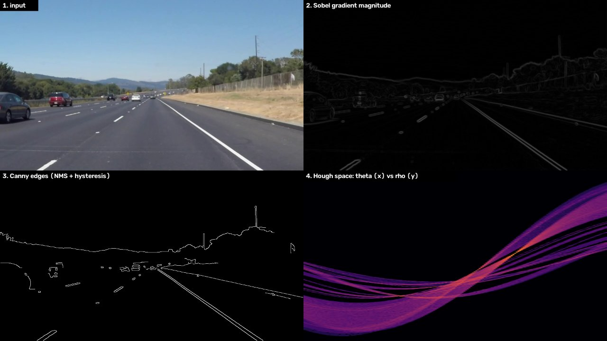
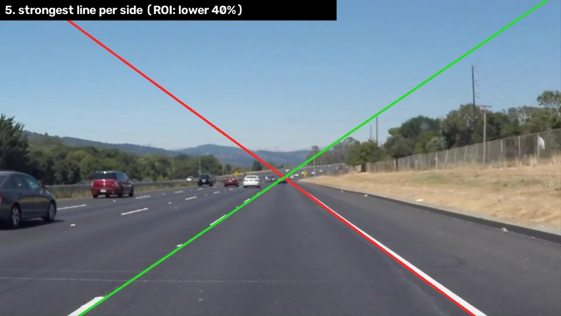

# Canny + Hough from scratch in C++17

Edge detection and line detection implemented **without OpenCV or any other library**: Gaussian blur,
Sobel gradients, non-maximum suppression, hysteresis thresholding and the Hough transform, plus a
small PGM/PPM reader/writer. Built with CMake, tested on Linux in CI (GitHub Actions, GCC + AddressSanitizer/UBSan).





*The Hough transform returns infinite lines (ρ, θ), which is why the drawn lines extend past the road.*

## Results

On a 960×540 highway frame ([Udacity test video](https://github.com/udacity/CarND-LaneLines-P1), MIT License):

| Check | Result |
|---|---|
| Edges vs OpenCV `cv2.Canny` (same σ, thresholds, L2 gradient), 1-pixel tolerance | precision 0.999, recall 0.987, **F1 0.993** |
| Full pipeline (blur → Sobel → NMS → hysteresis → Hough), single thread, `-O2` | about 40–55 ms per frame on an Intel i5-11320H laptop |
| OpenCV Canny alone on the same frame (SIMD-optimized) | about 6 ms |
| Lane lines found | left θ = 56°, right θ = 126° (strongest line on each side) |

The remaining ~1% difference to OpenCV comes from rounding: OpenCV blurs into an 8-bit image before
computing gradients, this code keeps floats throughout.

## How it works

| Stage | File | Idea |
|---|---|---|
| Grayscale | `src/filters.cpp` | 0.299 R + 0.587 G + 0.114 B |
| Gaussian blur | `src/filters.cpp` | separable: a 1-D kernel on rows, then on columns — O(k) instead of O(k²) per pixel; kernel radius 3σ; borders replicate the edge pixel |
| Sobel | `src/filters.cpp` | 3×3 derivative × smoothing; gx, gy and magnitude √(gx² + gy²) |
| Non-maximum suppression | `src/canny.cpp` | gradient direction quantized to 0/45/90/135°; a pixel survives only if it is the maximum along that direction → 1-pixel-wide edges |
| Hysteresis | `src/canny.cpp` | pixels ≥ high are edges; pixels in [low, high) are kept only if 8-connected to a strong edge (explicit stack, no recursion) |
| Hough transform | `src/hough.cpp` | each edge pixel votes for every line ρ = x·cosθ + y·sinθ through it; cos/sin lookup tables; peaks = local maxima of the accumulator (θ wraps around: (ρ, θ+π) ≡ (−ρ, θ)) |
| Lane demo | `app/main.cpp` | ignore the top 60% of the image, drop near-horizontal lines, keep the strongest line with θ < 90° (left) and θ > 90° (right) |

## Build and run

```bash
cmake -B build -DCMAKE_BUILD_TYPE=Release
cmake --build build
ctest --test-dir build --output-on-failure
mkdir -p out && ./build/cvfs_demo data/road.ppm out
```

The demo writes every stage: `1_gray.pgm`, `2_blur.pgm`, `3_gradient.pgm`, `4_edges.pgm`,
`5_hough_space.pgm`, `6_lines.ppm`, and prints the time of each stage.
Options: `--sigma 1.4 --low 50 --high 150 --votes 60 --lines 1 --roi 0.6 --min-angle 25`.

Compare with OpenCV (needs `pip install opencv-python numpy`):

```bash
./build/cvfs_demo data/road.ppm out --roi 0
python tools/compare_opencv.py data/road.ppm out/4_edges.pgm
```

Sanitizer build: `cmake -B build-asan -DCMAKE_BUILD_TYPE=Debug -DCVFS_SANITIZE=ON`.

## Tests

`tests/test_main.cpp` (no test framework, plain `CHECK` macro):

- Gaussian kernel sums to 1 and is symmetric; blurring a constant image leaves it unchanged
- Sobel on a vertical step gives gx > 0 and gy = 0
- Canny on a step edge produces exactly one edge pixel per row
- Hysteresis keeps weak pixels connected to a strong one and drops isolated weak pixels
- Hough finds a known vertical line (ρ = 30, θ = 0°) and the diagonal y = x (ρ = 0, θ = 135°)
- PPM write → read round trip

## Limitations

- Single-threaded scalar code; OpenCV is ~7× faster on Canny thanks to SIMD. Next steps: row-parallel loops with `std::thread`, integer arithmetic for the blur.
- The standard Hough transform returns infinite lines; a probabilistic Hough (line segments) would give endpoints.
- The lane demo uses a fixed ROI and straight-line model.

## License

MIT
